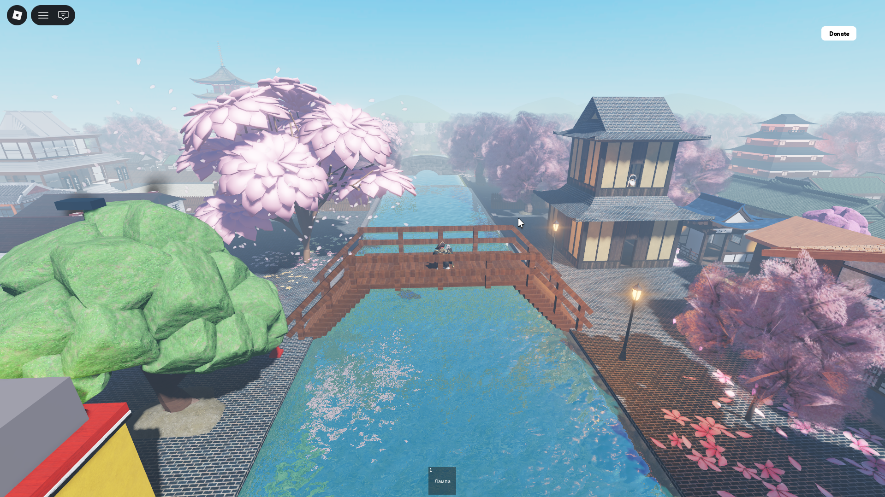
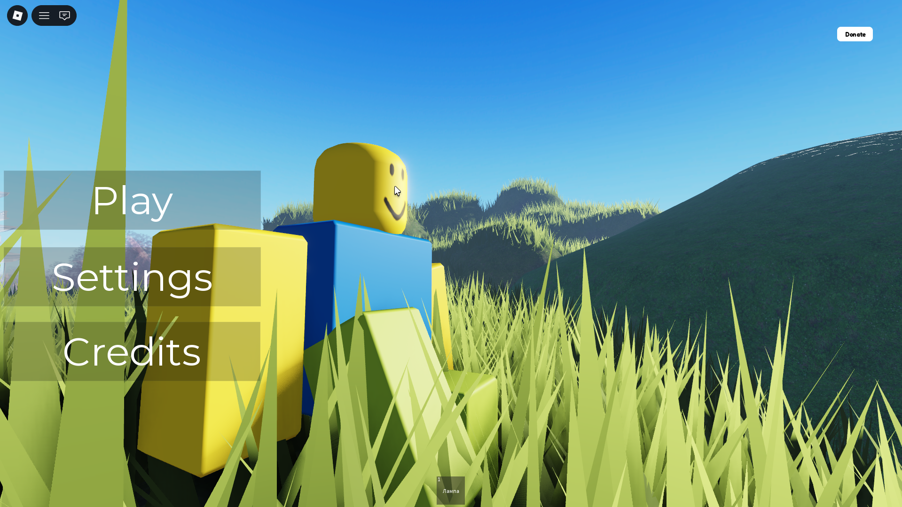
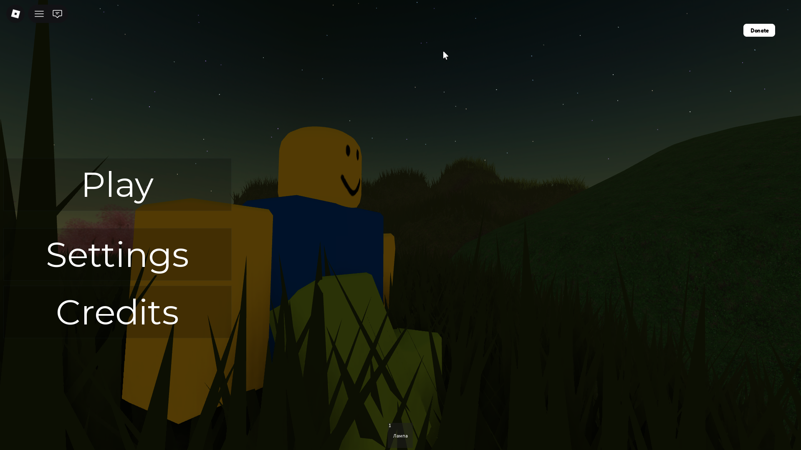
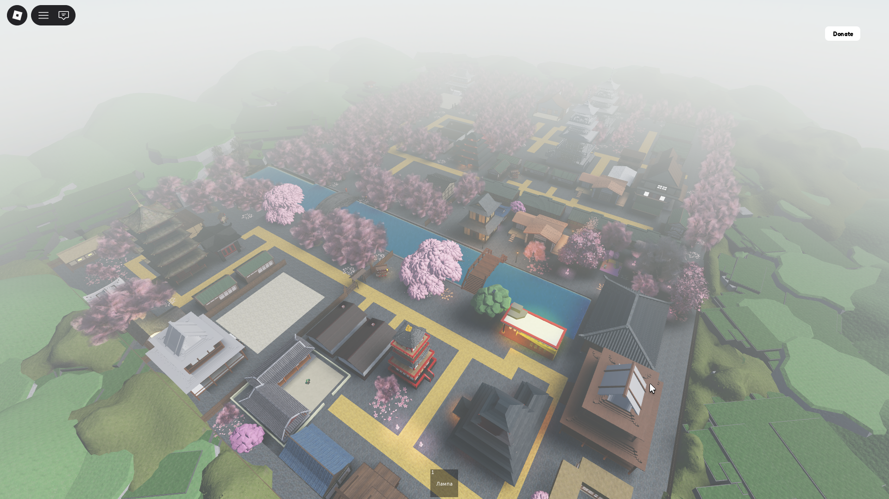
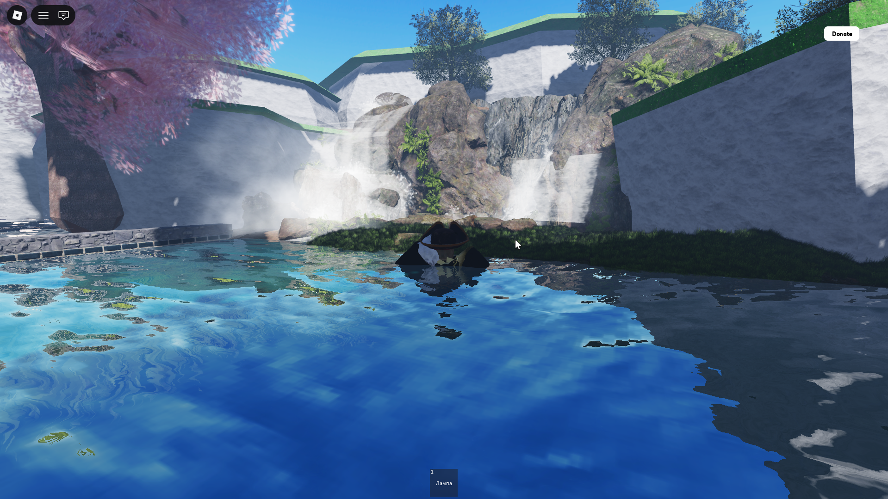
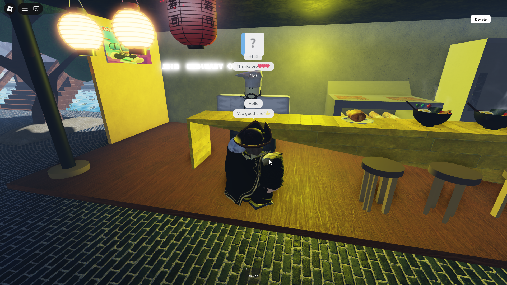

<div align="center">



<br/><br/>

# 🌸 Dream of Sakura

### *A peaceful Japanese world to explore on Roblox*

[](https://www.roblox.com/users/3152050706/profile)
[](https://www.roblox.com)
[](#)
[](#)

</div>

---

## 🍃 About

**Dream of Sakura** is a handcrafted, atmospheric Roblox experience set in a beautiful Japanese world. No quests, no combat, no stress — just you, the cherry blossoms, and a calming soundtrack.

Walk through a detailed Japanese city at dusk or under a starry night sky. Listen to the sound of flowing rivers, rustling sakura petals drifting in the breeze, and distant temple bells. It's a world built to make you slow down and breathe.

> *"Just walk around. That's all you need to do."*

---

## 🌙 Day & Night

The world shifts between beautiful **day** and **night** atmospheres, each with its own mood:

<div align="center">


<br/>
<em>Left: Golden hour warmth &nbsp;|&nbsp; Right: Starlit night with a tranquil atmosphere</em>
</div>

---

## 🏯 Explore the World

<div align="center">

<br/>
<em>Bird's eye view of the Japanese city — temples, canals, sakura trees and stone pathways</em>
</div>

<br/>

The map features a rich Japanese cityscape with:

- 🏯 **Traditional temples** and pagodas
- 🌸 **Sakura tree-lined canals** with flowing water
- 🌉 **Wooden bridges** over calm rivers
- 🏮 **Lantern-lit streets** glowing at night
- 🍜 **Restaurant interiors** with NPCs
- 💧 **Scenic waterfalls** tucked into the hills

---

## 🌊 Scenic Spots

<div align="center">


<br/>
<em>Left: Standing on a wooden bridge beneath falling sakura petals &nbsp;|&nbsp; Right: The hidden waterfall with crystal-clear waters</em>
</div>

---

## 🍜 Characters & Interiors

<div align="center">

<br/>
<em>Meet the local Chef NPC inside a lantern-lit Japanese restaurant</em>
</div>

<br/>

The world is filled with cozy interiors to wander into — restaurants with warm lighting, paper walls, and friendly NPCs that bring the world to life.

---

## 🎮 Features

| Feature | Description |
|---------|-------------|
| 🌸 **Cherry Blossoms** | Falling petals that drift across the entire map |
| 🌙 **Day / Night Cycle** | Two distinct atmospheric modes |
| 🎵 **Relaxing Soundtrack** | Ambient Japanese music that sets the mood |
| 🏯 **Detailed Architecture** | Hand-built temples, bridges, canals |
| 💧 **Dynamic Water** | Reflective rivers, waterfalls, and pools |
| 🍜 **NPC Interactions** | Friendly locals to talk to |
| 🌫️ **Atmospheric Fog** | Soft misty horizon for a dreamy feel |

---

## 🗺️ Map Overview

```
Dream of Sakura — World Layout

  🌄 Hills & Nature        🏯 Temple District
  ├── Waterfall            ├── Main Pagoda
  ├── Forest paths         ├── Shrine courtyard
  └── Scenic viewpoints    └── Stone gardens

  🏘️ City District         🌉 Canal District
  ├── Market streets       ├── Wooden bridges
  ├── Lantern alleys       ├── Sakura riverbanks
  └── Restaurant row       └── Reflective pools
```

---

## 🛠️ Technical Details

Built entirely in **Roblox Studio** using **Luau**, with a focus on visual atmosphere and world design.

| Aspect | Detail |
|--------|--------|
| **Engine** | Roblox Studio |
| **Scripting** | Luau |
| **Art Style** | Stylised realism — Japanese aesthetic |
| **Lighting** | Custom atmosphere, bloom & fog effects |
| **Water** | Dynamic reflection system |
| **Audio** | Spatial ambient music & environmental sounds |

---

## ▶️ Play Now

<div align="center">

### 🌸 Step into the world of sakura

[](https://www.roblox.com/users/3152050706/profile)

*Free to play · No stress · Just vibes*

</div>

---

## 👨‍💻 Developer

Made with ❤️ and patience by **Estemis** in Roblox Studio.

If the game gave you a moment of peace, leave a 👍 on the Roblox page — it means a lot!

---

<div align="center">
<sub>🌸 Built with Roblox Studio &nbsp;·&nbsp; Scripted in Luau &nbsp;·&nbsp; Inspired by traditional Japan 🌸</sub>
</div>
